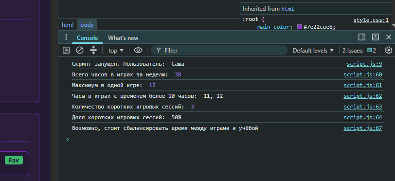
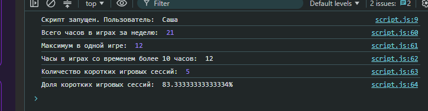

# Лабораторная работа №4. Основы JavaScript
Выполнил Прикуль Александр Группа 932404

## Описание проекта
Данный проект является продолжением Лабораторных работ №1–3. К странице подключён скрипт script.js, который реализует ввод/вывод (prompt, alert, console.log), условные конструкции, циклы и функции для обработки массива игрового времени.

## Выбранный вариант
Вариант 5. Тема «Геймер и разработчик игр» (время в игре)

## Использованные технологии
* HTML5
* CSS3
* JavaScript

## Реализованные требования:

* Реализован ввод имени через `prompt()` и вывод результатов через `alert()` и `console.log()`

* Реализованы условные конструкции (if) и циклы (for): проверка имени, циклы внутри функций, дополнительное условие по сумме часов

* Дополнительное условие: если сумма часов > 25, в консоль выводится предупреждение о балансе между играми и учёбой

* Написаны функции:
    * findMax — поиск максимума в массиве
    * popGamesFilter — фильтрация игр со временем более 10 часов
    * getSum — подсчёт суммы элементов массива
    * lightGamesCount — подсчёт количества лёгких игр <= 3 часов 

Пример работы дополнительного условия: при сумме часов меньше 25 предупреждение в консоль не выводится

